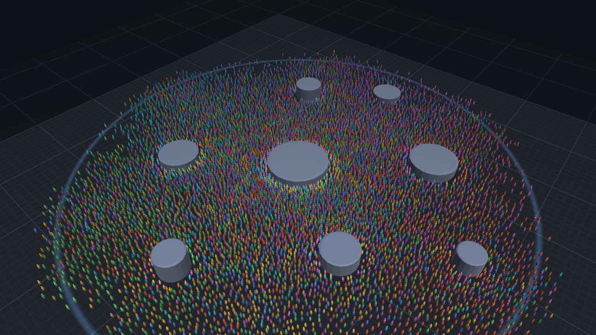
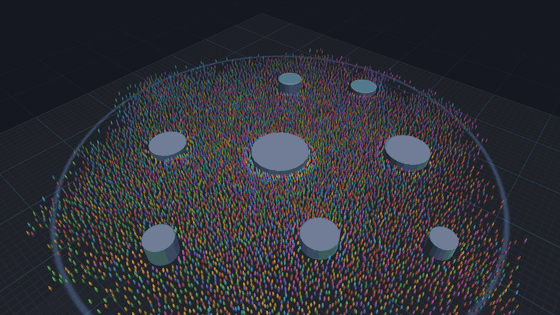

# WebGPU Crowd

**100,000 steering agents in your browser — a GPU crowd simulation written in raw WebGPU + WGSL, no engine, no framework.**

### ▶ [Live demo](https://iodiot.github.io/webgpu-crowd/) — https://iodiot.github.io/webgpu-crowd/

Open it in Chrome / Edge 113+ (or any browser with WebGPU enabled). Try `?agents=50000` for a stress test.



<details>
<summary>Animated capture (GIF)</summary>



</details>

<sub>Captures are real frames from the running demo (10k agents), recorded on a headless Linux box with Chrome's software WebGPU adapter (SwiftShader), so motion in the GIF is slower than on a real GPU.</sub>

## Features

- **Fully GPU-resident simulation** — positions, velocities and goals never leave the GPU; zero per-agent CPU work per frame.
- **Crowd steering in a compute shader**: separation, alignment, cohesion, goal seeking (agents stream between six gates on a ring) and obstacle avoidance with tangential flow + hard non-penetration constraint.
- **Spatial hash grid on the GPU** (counting sort: atomic binning → prefix-sum → scatter) for O(n) neighbour queries.
- **Instanced rendering** of low-poly flat-shaded pedestrians, oriented by velocity with a speed-based lean and walk bob; agents are coloured by destination.
- Procedural anti-aliased ground grid, obstacles, hemisphere + directional lighting, rim light, distance fog, 4× MSAA.
- **Orbit camera**: drag to orbit, right-drag / shift-drag to pan, wheel to zoom.
- **Controls** (lil-gui): agent count 1k–100k (default 10k), all behaviour weights, max speed, neighbour radius, time scale, pause (`Space`), re-seed.
- **Live stats**: FPS, frame time, **GPU time via `timestamp-query`** (when the adapter supports it), agent count, adapter.
- **Graceful fallback** screen when WebGPU is unavailable, plus device-lost handling.
- `?agents=50000` URL parameter for quick benchmarks.

## Architecture

```
src/
  main.ts            bootstrap, frame loop, fallback
  gpu.ts             adapter/device init, GPU timestamp timer
  sim/
    params.ts        tunables, world/grid constants, obstacle layout
    shaders.ts       WGSL compute kernels
    CrowdSim.ts      buffers, bind groups, compute pipelines, pass encoding
  render/
    shaders.ts       WGSL vertex/fragment shaders (agents, obstacles, ground)
    Renderer.ts      render pipelines, MSAA/depth targets, draw encoding
    mesh.ts          procedural low-poly meshes (lathe + flat normals)
    camera.ts        orbit camera
    math.ts          tiny mat4 helpers (WebGPU z ∈ [0,1])
  ui/
    gui.ts           lil-gui panel bound to the live params object
    stats.ts         stats overlay
```

### GPU buffers

All buffers are allocated once for `MAX_AGENTS = 100 000`; changing the count only changes dispatch size and instance count — no reallocation, no hitches.

| Buffer | Type | Contents |
|---|---|---|
| `agentsA` / `agentsB` | `array<vec4f>` | ping-pong state: `pos.xz, vel.xz` |
| `meta` | `array<vec4f>` | `goal.xz, speedScale, goalIndex` |
| `cellCount` | `array<atomic<u32>>` | agents per grid cell (80×80 cells of 2×2 units) |
| `cellStart` | `array<u32>` | exclusive prefix sum of `cellCount` |
| `agentCell` | `array<vec2u>` | `(cell, slot within cell)` per agent |
| `sortedIdx` | `array<u32>` | agent indices sorted by cell |
| `params` | uniform | weights, dt, grid constants, obstacles (shared with the renderer) |

### Compute passes (one compute pass, five dispatches per frame)

1. **`clearGrid`** — zero `cellCount`.
2. **`countAgents`** — hash each agent to its cell; `atomicAdd` returns a unique slot, stored in `agentCell`. This makes the sort stable-free and avoids a second atomic pass.
3. **`scanCells`** — single 256-thread workgroup: each thread sums a contiguous chunk of cells, a Hillis–Steele scan in workgroup memory combines chunk sums, then each thread writes the exclusive offsets for its chunk. 6 400 cells → 25 cells/thread, trivially cheap.
4. **`scatter`** — `sortedIdx[cellStart[cell] + slot] = i`. Agents in the same cell are now contiguous.
5. **`steer`** — each agent visits its 3×3 cell neighbourhood (cell size ≥ neighbour radius guarantees completeness), accumulates separation / alignment / cohesion, adds goal-seeking, obstacle avoidance (look-ahead + tangential term so agents flow around instead of stalling) and a soft boundary, clamps force and speed, integrates, enforces a hard obstacle constraint, and writes to the *other* ping-pong buffer — so reads and writes never race.

WebGPU inserts the necessary storage barriers between dispatches, so the whole step is a single compute pass with no CPU synchronisation.

### Rendering

One MSAA render pass draws the ground (procedural quad, grid via `fwidth`), instanced obstacle cylinders (read from the same uniform the simulation uses), and `agentCount` instances of the pedestrian mesh. The vertex shader indexes the latest agent buffer with `instance_index`, builds a basis from the velocity, and transforms the mesh — no instance vertex buffer, no CPU copies.

## Performance notes

- Cost is O(n): ~5 tiny dispatches + one instanced draw (~150 triangles/agent).
- Per-cell neighbour iteration is capped (`MAX_PER_CELL = 32`) so very dense clumps can't blow up the worst case.
- Neighbour queries read `sortedIdx` → `agentsIn`; a further optimisation is to scatter the agent data itself (not just indices) into cell order for better cache coherence, or periodically reorder agents by cell.
- The single-workgroup scan is fine for this grid size; for much larger worlds use a multi-level (reduce-then-scan) prefix sum.
- At 100k agents the bottleneck on most GPUs is vertex/raster work, not simulation — the `GPU` stat (compute start → render end) makes this easy to see. Lowering the mesh LOD or adding distance-based impostors would be next.
- Measure on your hardware and put the numbers here, e.g. _"10k agents: X ms GPU, 100k agents: Y ms GPU on <GPU>"_.

## Run locally

Requires Node 20+ and a WebGPU-capable browser (Chrome/Edge 113+, Safari 26+, Firefox with WebGPU enabled).

```bash
npm install
npm run dev        # http://localhost:5173/webgpu-crowd/
npm run build      # type-check + production build to dist/
npm run preview    # serve the production build
npm run lint
```

## Deploy to GitHub Pages

`vite.config.ts` sets `base: '/webgpu-crowd/'`, so the repository should be named **`webgpu-crowd`** (otherwise change `base`).

The live demo is served from the `gh-pages` branch (Settings → Pages → Deploy from a branch → `gh-pages` / root):

```bash
npm run build
touch dist/.nojekyll
# publish the contents of dist/ to the gh-pages branch, e.g.
npx gh-pages -d dist --dotfiles
```

## License

[MIT](LICENSE) © Mike Smahin
